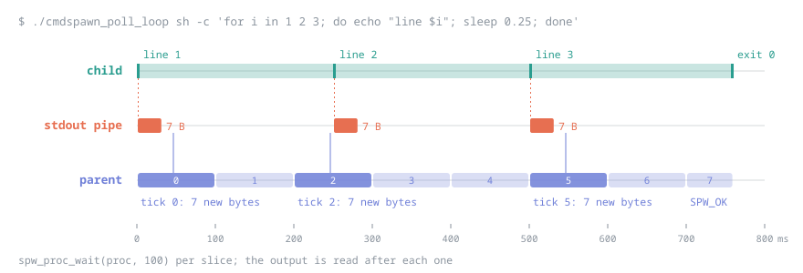

# cmdspawn

Start another program from C without a shell, collect what it prints and put a time limit on it,
with one API on Linux, macOS, BSD and Windows.

## Quick start

[`examples/basic.c`](examples/basic.c) runs a command, waits for it and prints its output. With
no arguments it runs itself as the child:

```c
spw_cmd_t *cmd = NULL;
spw_proc_t *proc = NULL;
const unsigned char *out;
size_t out_len = 0;
int code = 0;
int status;

status = spw_cmd_create(NULL, NULL, NULL, &cmd);
if (status == SPW_OK)
    status = spw_cmd_args(cmd, args, args_len);
if (status == SPW_OK)
    status = spw_cmd_stdio(cmd, SPW_STDOUT, SPW_PIPE);
if (status == SPW_OK)
    status = spw_cmd_timeout(cmd, 5000);
if (status == SPW_OK)
    status = spw_spawn(cmd, &proc);
if (status == SPW_OK)
    status = spw_proc_wait(proc, -1);
if (status == SPW_OK)
    status = spw_proc_status(proc, &code, NULL);
if (status == SPW_OK) {
    out = spw_proc_output(proc, SPW_STDOUT, &out_len);
    printf("exit code %d, output: %.*s", code, (int)out_len, (const char *)out);
}
spw_proc_destroy(proc);
spw_cmd_destroy(cmd);
```

```console
$ ./cmdspawn_basic
exit code 0, output: hello from the child
$ ./cmdspawn_basic uname -s
exit code 0, output: Linux
```

| | Starts with | Kills the tree through | Handle for an event loop |
| --- | --- | --- | --- |
| Linux | `posix_spawn` | process group | pipes, and a pidfd on 5.3 or later |
| macOS, BSD | `posix_spawn` | process group | pipes; `spw_proc_pid` for kqueue |
| Windows | `CreateProcessW`, UTF-8 turned into UTF-16 | job object | overlapped pipe events and the process handle |

## Why

`system()` and `popen()` hand a string to a shell, so every argument has to survive quoting,
and they give back either the exit code or one stream, never both, with no way to stop a child
that hangs. Doing it properly means `posix_spawn` and file actions on one side and
`CreateProcessW`, job objects and overlapped pipes on the other, plus the Windows command line,
which each program splits again by its own rules. cmdspawn wraps all of that: the command is an
argument list, output is read without deadlocking on large amounts, and a time limit takes down
the child and everything it started.

## API tour

Every call that can fail returns `SPW_OK` or an error code, and `spw_strerror` describes it.
`spw_cmd_create` and `spw_spawn` hand out objects that only `spw_cmd_destroy` and
`spw_proc_destroy` release; both accept `NULL`. Nothing takes ownership of its arguments, so a
command can be changed, reused or destroyed after `spw_spawn`. An allocator passed to
`spw_cmd_create` replaces `malloc` and `free` for the command and the processes it starts. All
text is UTF-8.

### Describing the command

- `spw_cmd_args` appends arguments, the program first. A bare name is looked up in the `PATH`
  of the child's environment (`/usr/bin:/bin` when there is none on POSIX). On Windows the
  system directory comes after `PATH`, `.exe` is added to a name without extension, and the
  current directory is never searched. A relative path counts from the child's working
  directory.
- `spw_cmd_env` sets a variable, or removes it when `value` is `NULL`; `spw_cmd_env_clear`
  starts from an empty environment. Names are case-insensitive on Windows.
- `spw_cmd_stdio` chooses per stream between `SPW_INHERIT` (the default), `SPW_NULL`,
  `SPW_PIPE` and, for stderr, `SPW_MERGE` into stdout.
- `spw_cmd_input` copies bytes to feed on stdin, which closes once they are written; a stdin
  pipe without input is an immediate end of file. A later `spw_cmd_stdio` on stdin drops them.
- `spw_cmd_input_open(cmd, 1)` keeps stdin open for a conversation with the child:
  `spw_proc_write` queues more bytes, written as the pipe accepts them, and
  `spw_proc_close_input` ends stdin once the queue is empty. After stdin closes, by the caller
  or because the child stopped reading, `spw_proc_write` returns `SPW_ERR_IO`.
- `spw_cmd_timeout` limits the run in milliseconds from `spw_spawn` (`0` is no limit), and
  `spw_cmd_kill_grace` sends `SIGTERM` first and `SIGKILL` only `grace_ms` later. Windows kills
  at once.
- `spw_cmd_same_group(cmd, 1)` keeps the child in the caller's process group, which an editor,
  a pager or a password prompt needs to read the terminal. Kills then reach only the child, not
  its descendants. On Windows the job object still holds the tree.
- `spw_cmd_output_limit` caps the bytes kept per stream; the child is never blocked, and bytes
  past the cap are read and dropped. `spw_cmd_output_fn` passes each chunk to a callback
  instead of keeping it; a non-zero return kills the tree and `spw_proc_wait` returns
  `SPW_ERR_STOPPED`.

### Starting it

`spw_spawn` says why a program did not start: `SPW_ERR_NOTFOUND` (not in `PATH` or not at the
path), `SPW_ERR_ACCESS` (no execute permission, a directory), `SPW_ERR_FORMAT` (a script without
`#!`, a binary for another machine) or `SPW_ERR_SPAWN` (process or descriptor limits).

`spw_spawn_detached(cmd, &pid)` starts a program and forgets it, filling `pid` if asked. On POSIX
it runs in a new session through an intermediate process that exits at once, so there is no
zombie; on Windows it stays out of any job and gets its own process group. Only inherited or
`SPW_NULL` streams are allowed.

### Waiting and polling

`spw_proc_wait(proc, timeout_ms)` moves data through the pipes and returns `SPW_OK` once the
process has exited and its output pipes are closed. `-1` waits as long as it takes, `0` does
only what is ready, and `SPW_ERR_AGAIN` means it is still running. Past the time limit the tree
is killed and the call returns `SPW_ERR_TIMEOUT` from then on.



That is [`examples/poll_loop.c`](examples/poll_loop.c) on Linux, waiting in 100 ms slices on a
child that prints a line every 250 ms. It printed `tick 0`, `tick 2` and `tick 5`, each with 7
new bytes, and the eighth wait returned `SPW_OK` as the child exited, about 760 ms in. To wait inside your own event loop
instead, `spw_proc_handle` gives the pipe descriptors (POSIX), a pidfd for `SPW_PROCESS` on
Linux 5.3 or later, or the events and process handle on Windows, and `SPW_NO_HANDLE` once a
stream is closed; when one is ready, call `spw_proc_wait(proc, 0)`.

### After it ends

- `spw_proc_status` gives the exit code and, on POSIX, the signal; a signal means exit code
  `-1`, and a killed Windows process exits with `1`.
- `spw_proc_output` returns the captured bytes, valid until the next `spw_proc_wait` or
  `spw_proc_destroy`; `spw_proc_dropped` counts what the output limit threw away.
- `spw_proc_killed` tells a kill (by `spw_proc_kill`, the time limit or the callback) from a
  normal end, the only way on Windows to tell a kill from `exit(1)`.
- `spw_proc_kill` kills the tree now and `spw_proc_terminate` asks it to stop with `SIGTERM`
  (`SPW_ERR_UNSUPPORTED` on Windows).
- `spw_proc_destroy` kills and collects a process that still runs. On POSIX an ended process
  stays a zombie until then, so its pid and process group cannot be reused and a late kill
  never reaches an unrelated group.

### Windows command lines

`spw_win_quote` builds the command line that `CommandLineToArgvW` and the Microsoft C runtime
both split back into exactly the given arguments. It is plain string logic and builds on every
system. The program name cannot contain `"`; `SPW_ERR_RANGE` means the buffer is too small, and
`NULL` with `0` asks for the length.

### What it cannot do

- POSIX children get their own process group. One that reads a terminal from the background
  is stopped by `SIGTTIN`, so give it `SPW_NULL` or `SPW_PIPE` on stdin. Descendants that start
  their own group or session (daemons, shells with job control) leave the tree.
- On Windows, descendants created with `CREATE_BREAKAWAY_FROM_JOB` leave the tree, and `.bat`
  and `.cmd` files are refused with `SPW_ERR_UNSUPPORTED`, since `cmd.exe` quotes differently.
  Run `cmd.exe /c` yourself if you need one.
- A descendant that keeps an output pipe open after the child exits keeps `spw_proc_wait`
  waiting. Set a time limit when that can happen.

## Building

```sh
cmake -S . -B build -DBUILD_SHARED_LIBS=ON
cmake --build build
cmake --install build --prefix /usr/local
```

```cmake
find_package(cmdspawn REQUIRED)
target_link_libraries(app PRIVATE cmdspawn::cmdspawn)
```

Without CMake: `cc app.c $(pkg-config --cflags --libs cmdspawn)`.

The library also comes as one header. `scripts/amalgamate.sh` writes `dist/cmdspawn/cmdspawn.h`;
copy the `cmdspawn` folder onto your include path and, in one `.c` file, before any other
include:

```c
#define SPW_IMPLEMENTATION
#include "cmdspawn/cmdspawn.h"
```

`SPW_STATIC` keeps every function private to that file.

## Tests

```sh
cmake --preset dev && cmake --build build/dev && ctest --preset dev
```

The `dev` preset builds with ASan, UBSan and `-Werror`. The suite starts a helper program to
check arguments, environment, pipes, time limits, process groups, start errors and
allocation failures, and compares `spw_win_quote` with a reference splitter on every platform; `cmake --preset fuzz` builds
`fuzz_win_quote`, which feeds it random arguments. On each push, CI also builds with MSVC,
installs on Linux, macOS and Windows, and checks the ABI against `abi/cmdspawn.abi`.

Versions follow Semantic Versioning, with the soname bumped on every major release; the
[CHANGELOG](CHANGELOG.md) lists what changed. Security reports go through
[SECURITY.md](SECURITY.md). License: MIT ([LICENSE](LICENSE)).
